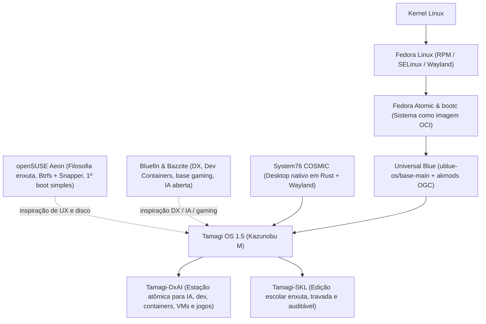

# O Tamagi OS no Universo Linux

Este guia explica **o que é o Tamagi OS**, de qual linhagem ele vem, como ele se diferencia das distribuições tradicionais e imutáveis, e qual lugar único ele ocupa no ecossistema Linux atual.

---

## 1. Onde o Tamagi fica na árvore genealógica do Linux

No universo Linux existem três grandes troncos de pacotes (**Debian/Ubuntu**, **Arch** e **Fedora/Red Hat**), além de famílias independentes (**openSUSE**, **NixOS**, **Gentoo**).

O **Tamagi OS** pertence à geração mais recente do ecossistema **Fedora / Cloud-Native Linux**: ele é um **sistema operacional atômico baseado em Bootable Containers (`bootc` + `composefs`)**, construído sobre a base **Universal Blue**, com o desktop **COSMIC** (em Rust) e kernel **OGC** (o mesmo usado em distros modernas de alto desempenho como o Bazzite).



### Em uma frase
> **O Tamagi é o ponto de encontro entre a simplicidade enxuta do openSUSE Aeon, a engenharia Cloud-Native/DX do Universal Blue (Bluefin/Bazzite) e o desktop moderno em Rust do COSMIC — projetado desde o núcleo para fluxos com IA local e agentes autônomos seguros.**

---

## 2. As 3 gerações de distros Linux (e onde o Tamagi está)

Para entender por que o Tamagi funciona de um jeito diferente de um Ubuntu ou Arch comum, vale enxergar as três gerações de arquitetura no Linux desktop:

| Geração | Exemplos | Como o sistema funciona | Pontos fortes e limites |
|---|---|---|---|
| **1ª — Clássicas (Mutáveis)** | Ubuntu, Linux Mint, Debian, Arch, Fedora Workstation, Pop!_OS | `apt`, `dnf` ou `pacman` alteram arquivos direto em `/usr` ao vivo. | Máxima familiaridade, mas uma atualização interrompida ou PPA/AUR conflitante pode quebrar o sistema; difícil reproduzir a máquina exatamente. |
| **2ª — Imutáveis clássicas** | Fedora Silverblue/Kinoite, openSUSE Aeon/MicroOS, SteamOS, NixOS | `/usr` é somente-leitura; atualizações criam uma nova versão inteira com rollback. | Muito mais confiável; porém ferramentas tradicionais como `rpm-ostree` ou configurações complexas criam atrito para instalar drivers, apps nativos ou pacotes de dev. |
| **3ª — Bootable Containers (`bootc` + `composefs`)** | Universal Blue (nova geração), Bluefin Dakota, **Tamagi OS** | O SO inteiro é uma **imagem OCI assinada** (`cosign`) entregue via registry (GHCR), iniciada com **`systemd-boot`**, com verificação de integridade e extensões reversíveis (`systemd-sysext`). | Atualização 100% atômica em segundo plano, rollback automático com quarentena, zero "sujeira" acumulada no `/usr` e extensibilidade limpa sem recompilar a imagem. |

O **Tamagi OS** já nasce integralmente na **3ª geração** (`bootc` + `composefs` + `systemd-boot` + Btrfs subvolumes), sem carregar o legado do GRUB ou de gerenciadores mistos.

---

## 3. Como o Tamagi se compara às principais distros

| Distro | Base | Desktop | Foco principal | Como o Tamagi se diferencia |
|---|---|---|---|---|
| **Ubuntu / Linux Mint** | Debian | GNOME / Cinnamon | Uso geral tradicional | O Tamagi é atômico (não quebra em updates), tem rollback automático com quarentena, snapshots Btrfs da home (`tamagi rewind`) e já nasce pronto para containers e IA. |
| **Pop!_OS** | Ubuntu | COSMIC | Produtividade e criadores | Ambos usam **COSMIC**, mas o Pop!_OS é mutável (APT/Ubuntu), enquanto o Tamagi entrega o COSMIC sobre uma base atômica `bootc` + Fedora 45 + kernel OGC + paleta **Ipê / Material 3**. |
| **Arch / CachyOS** | Arch | Vários | Controle total e pacotes bleeding-edge | O Tamagi entrega desempenho moderno (kernel OGC + `sched_ext` `scx_rustland`/`scx_rusty`), mas **sem manutenção manual**: quem quiser pacotes Arch/AUR usa `tamagi dev box create arch` sem arriscar o host. |
| **Fedora Silverblue / COSMIC Atomic** | Fedora | GNOME / COSMIC | Desktop atômico "puro" | O Tamagi elimina a fricção do `rpm-ostree` com camadas reversíveis `tamagi layer` (`systemd-sysext`), instalador próprio com preservação de `/var/home`, codecs/multimídia, IA local (`llama.cpp` Vulkan) e CLI única (`tamagi`). |
| **Bluefin / Bazzite** | Universal Blue | GNOME / KDE | DX Cloud-Native (Bluefin) e Jogos (Bazzite) | O Tamagi bebe diretamente da mesma família Universal Blue, mas adota **COSMIC** (Rust), é **mais enxuto na base** (instala tudo sob demanda), traz **jaula agêntica com Shadow CoW + Egress Guard + `flights`** e oferece a edição escolar **Tamagi-SKL** na mesma ISO. |
| **openSUSE Aeon** | openSUSE | GNOME | Desktop imutável minimalista "que não atrapalha" | O Tamagi adota a mesma disciplina minimalista (base limpa, Flatpaks `--user`, snapshots Btrfs, primeiro login simples), somando `bootc`, COSMIC, `tamagi layer`, `mise` nativo e stack completa de IA/agentes. |
| **ChromeOS Flex** | ChromiumOS | Ash | Escolas, laboratórios e terminais web | O **Tamagi-SKL** ocupa exatamente esse espaço — mas 100% **Linux aberto, sem conta Google obrigatória**, com painel travado, limpeza automática de login/cookies mantendo histórico auditável de 15 dias e gestão remota por SSH/Cockpit. |

---

## 4. A arquitetura em camadas do Tamagi (o "modelo mental")

No Tamagi, **cada tipo de software mora no lugar certo**, para que você tenha velocidade nativa onde importa e isolamento onde reduz risco:

```text
┌───────────────────────────────────────────────────────────────────────────┐
│ Camada 4 · Projetos pesados e isolamento total                            │
│   VS Code + Dev Containers (Podman) · Distrobox (Fedora/Ubuntu/Arch/SUSE) │
│   Bancos locais & MCPs em Podman Quadlets · VMs QEMU/KVM (Cockpit)        │
├───────────────────────────────────────────────────────────────────────────┤
│ Camada 3 · Runtimes, CLIs e Agentes de IA no usuário (~/.local)           │
│   mise nativo (Node/Python/uv/Go/Rust) · Claude, Codex, Qwen, Gemini, agy │
│   Protegidos por agent-jail (bwrap) + Shadow CoW Btrfs + Egress Guard     │
├───────────────────────────────────────────────────────────────────────────┤
│ Camada 2 · Aplicativos gráficos (Flatpak --user em /var/home)             │
│   Flathub + COSMIC Flatpak · portáteis e isolados (zero Flatpak sistema)  │
├───────────────────────────────────────────────────────────────────────────┤
│ Camada 1 · Extensões nativas reversíveis (tamagi layer / systemd-sysext)  │
│   Chrome/Firefox/Vivaldi nativos · Steam/Lutris · NVIDIA/ROCm · VS Code   │
│   Docker · Wireshark/LACT/Sniffnet · removíveis em 1 comando sem reboot   │
├───────────────────────────────────────────────────────────────────────────┤
│ Camada 0 · Imagem base atômica somente-leitura (bootc + composefs)        │
│   Universal Blue (Fedora 45) · Kernel OGC (sched_ext + NPUs) · COSMIC     │
│   llama.cpp (Vulkan/CPU) · Podman · Tailscale · systemd-boot + Snapper    │
└───────────────────────────────────────────────────────────────────────────┘
```

### Por que essa separação muda o jogo
- **Sistema base imutável (`Camada 0`):** nunca acumula lixo de pacotes quebrados; atualizações chegam assinadas (`cosign`) do GHCR e, se um boot falhar, o `tamagi-boot-check` volta sozinho para a versão anterior e coloca o digest ruim em quarentena.
- **Nativo quando realmente precisa (`Camada 1`):** drivers de GPU, `ROCm`, `Steam`, `VS Code` e `Chrome` nativo entram como camadas `systemd-sysext` reversíveis (`tamagi install --native ...` / `tamagi remove ...`) — sem mexer nos bytes do sistema base.
- **IA segura por padrão (`Camada 3`):** o Tamagi trata **agentes de IA que executam código** como cidadãos de primeira classe — com `llama.cpp` (Vulkan) local pronto, `mise` nativo no `DxAI` para rodar agentes/MCPs sem atrito, jaula por projeto (`agent-jail`), clones instantâneos Btrfs (`--shadow`), firewall de saída por domínio (`--egress-guard`) e caixa-preta de auditoria (`tamagi ai flights`).

---

## 5. Duas edições na mesma ISO

Uma característica rara no universo Linux é o Tamagi entregar **duas edições com propósitos distintos** a partir do mesmo `Containerfile`, deduplicadas na mesma ISO:

1. **`Tamagi-DxAI`** *(estação de trabalho & IA)*
   - Para desenvolvedores, engenheiros, entusiastas de IA local/agêntica e usuários avançados.
   - Traz COSMIC completo com tiling, `llama.cpp` Vulkan, `mise` nativo, `cosmic-ext-storage` + `rclone`, `btm`, QEMU/KVM + Cockpit Machines sob demanda, base gaming Bazzite (`gamescope`, `mangohud`, `gamemode`, Vulkan 32/64-bit) e toda a suíte `tamagi ai`.
2. **`Tamagi-SKL`** *(escola & laboratório)*
   - Alternativa aberta, leve e controlada ao ChromeOS/Windows em ambientes educacionais.
   - Remove loja gráfica, `llama.cpp`, `mise`, `libvirt` e extras de dev; cria duas contas (`admin` com `sudo` + `aluno` com autologin sem `sudo`), trava o painel COSMIC, gerencia o Chromium (sem salvar senhas, limpa login/cookies ao fechar, histórico auditável de 15 dias) e habilita gestão remota via SSH (`wheel`) + Cockpit + `tamagi sys skl`.

---

## 6. Para quem o Tamagi é — e para quem não é

### O Tamagi foi feito para você se:
- Quer um **Linux moderno, rápido e praticamente inquebrável**, sem precisar "consertar" atualizações;
- Trabalha com **código, containers, VMs ou agentes de IA** (locais ou na nuvem) e quer segurança real ao deixar agentes mexerem em repositórios;
- Gosta da limpeza do **COSMIC (Rust)** com visual sóbrio (**Ipê / Material 3**), mas prefere base **Fedora/Universal Blue atômica** em vez de Debian/APT;
- Precisa implantar **laboratórios escolares ou máquinas de estudo** padronizadas e auditáveis (`Tamagi-SKL`).

### Talvez outra distro combine mais se:
- Você quer modificar `/usr` livremente via `pacman`/`apt` todos os dias e compilar pacotes do sistema manualmente (melhor ir de **Arch**, **CachyOS** ou **Gentoo**);
- Você depende exclusivamente de **GNOME** ou **KDE Plasma** já integrados de fábrica (melhor ir de **Bluefin**, **Aurora**, **Bazzite** ou **openSUSE Aeon**);
- Você prefere um sistema declarativo 100% baseado em linguagem funcional desde o kernel até o `~/.bashrc` (melhor ir de **NixOS**).

---

## 7. Resumo da filosofia em 11 comandos (`tamagi`)

Em vez de espalhar dezenas de ferramentas desconexas, o Tamagi concentra o sistema inteiro em uma CLI estática em Rust:

| Comando | Papel no sistema |
|---|---|
| `tamagi ai` | IA local (`llama.cpp`), agentes de código, `run --shadow`, `egress-guard`, `flights` e MCP Quadlets |
| `tamagi dev` | Caixas Distrobox (`fedora`/`ubuntu`/`arch`/`opensuse`), bancos locais, workspaces, `try` e `isolate` |
| `tamagi install` | Catálogo curado + busca ao vivo no Flathub + instalações `--native` (`sysext`) e `--flatpak` |
| `tamagi remove` | Desinstalação unificada (Flatpak, navegadores, camadas nativas, apps do catálogo e agentes) |
| `tamagi update` | Atualização atômica completa (imagem `bootc`, camadas, Flatpaks, caixas, agentes, `mise`, Quadlets) |
| `tamagi rewind` | Linha do tempo unificada de snapshots da pasta pessoal (Snapper) e versões do sistema |
| `tamagi layer` | Gerenciamento direto das camadas nativas reversíveis `systemd-sysext` |
| `tamagi vm` | Máquinas virtuais QEMU/KVM com Cockpit Machines (ativadas sob demanda por socket) |
| `tamagi shield` | Endurecimento (`harden`), permissões temporárias (`lease`), modo privacidade e `tailscale` |
| `tamagi sys` | `doctor`, `status`, `setup`, `perf` (`sched_ext`), `desktop`, `skl` e estado declarativo (`tamagi.toml`) |
| `tamagi why` | Inspetor instantâneo de proveniência para qualquer arquivo, comando, porta ou serviço do sistema |

---

*Guias relacionados:* [Guia de Atualização Atômica (`docs/atualizacao.md`)](./atualizacao.md) · [Roadmap 2.0 "Tachico B" (`ROADMAP-2.0.md`)](../ROADMAP-2.0.md)
