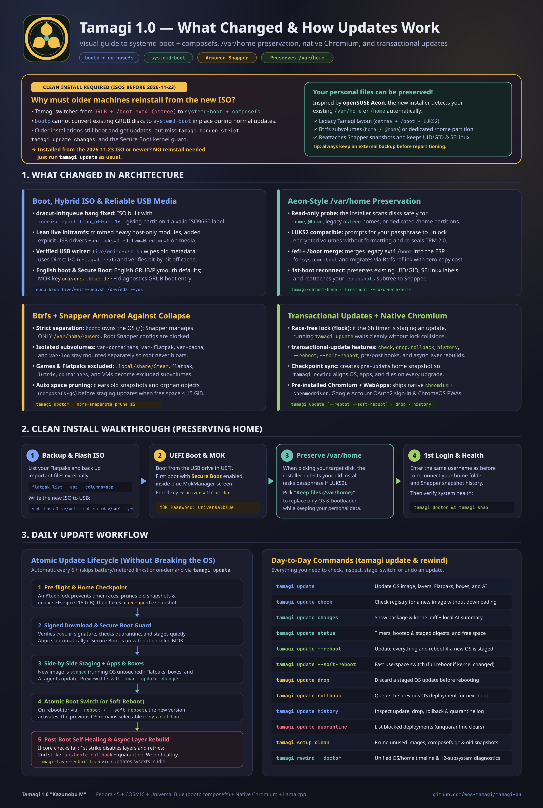
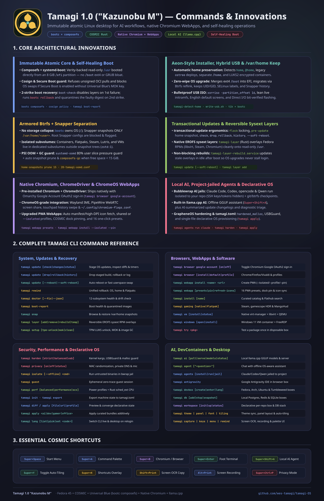

# Tamagi guide: install, migrate and update

This guide covers three things: how to get to Tamagi (fresh install, or
migration from Bluefin/Aurora), what it offers, and how to keep it up to date.

## 1. Fresh install or migration?

> **Clean install required (Tamagi installed before 2026-11-23).** Tamagi now
> boots with systemd-boot on bootc's composefs backend: an 8 GiB EFI partition
> at `/efi`, one Btrfs with subvolumes, no `/boot` partition and no GRUB. bootc
> cannot convert an existing GRUB installation in place. A machine installed
> from an older ISO keeps booting and keeps receiving updates, but it stays on
> the old layout and misses `tamagi harden strict`, `tamagi update changes` and
> the Secure Boot guard. To get the full system: back up your files first, then
> install from the new ISO — the installer automatically detects existing
> `/var/home` (including LUKS2 and previous GRUB/ostree layouts) and offers to
> preserve your personal files Aeon-style instead of wiping them.
>
> Visual guides:
>
> 
>
> 

| Situation | Recommendation |
|---|---|
| I already use Tamagi, installed from the ISO of 2026-11-23 or later | **Update** (`tamagi update`). Never reinstall to update. |
| I already use Tamagi, installed from an older ISO | **Clean install** from the new ISO, once (you can keep `/var/home` when prompted by the installer). Until then, updates keep arriving. |
| I use Bluefin or Aurora and want Tamagi as my main system | **Fresh install** from the ISO, with a copy of the home folder. |
| I use Bluefin or Aurora and want to try it without formatting | **Migration** with `bootc switch` (section 3), knowing its limits. |

Why a fresh install is the recommendation for who comes from another system:

- **A different desktop.** Bluefin uses GNOME and Aurora uses KDE; Tamagi uses
  COSMIC. Migration swaps the system image, but `/etc` and your home folder
  stay as they were, with the old desktop's settings.
- **The disk stays as the old installer left it.** Home-folder snapshots
  (`tamagi rewind`), compression and mount options are prepared by Tamagi's
  installer. A migrated machine may not have them.
- **Migration from Bluefin/Aurora has not been tested by the project yet.**
  Installation from the ISO and updates from Tamagi to Tamagi are tested in a
  virtual machine on every round.

## 2. Fresh install (recommended)

1. **Copy your files** to an external disk or another computer. Installation
   erases the chosen disk completely.
2. Note what you want to reinstall: `flatpak list --app --columns=application`
   lists your Flatpak apps.
3. Write the Tamagi ISO to a USB drive and boot from it.
4. With **Secure Boot** on, the first start asks to enroll Universal Blue's
   key (the same one Bluefin and Aurora use): password `universalblue`. A
   machine that already runs Bluefin/Aurora usually has it enrolled.
5. Follow the installer: language (English is the default; Brazilian
   Portuguese comes next), keyboard, time zone, account, disk encryption and
   the disk.
6. At first login a window offers the basics to tick and optional extra browsers
   (Chromium ships pre-installed natively with ChromeDriver and Google Account
   sign-in; Opera GX, Chrome, Firefox and Vivaldi stay optional). Each item
   says how it is installed. Nothing is mandatory; everything else, including
   the ready-made profiles, can be installed later with `tamagi install` (a
   name that is not in the catalog is looked up on Flathub).
7. Copy your files back and reinstall your Flatpaks.

## 3. Migrating from Bluefin or Aurora, without formatting

Bluefin, Aurora and Tamagi belong to the same family (Universal Blue bootc
images), so an installed system can be pointed at Tamagi's image. **This path
has not been tested by the project; copy your files first.**

A migrated machine keeps the disk layout it was installed with (GRUB and the
ostree backend). Tamagi is built for systemd-boot with bootc's composefs
backend, and bootc cannot convert one into the other in place. On a migrated
machine the automatic update and `bootc rollback` work, but `tamagi harden
strict` (kernel parameters), `tamagi update changes` and the Secure Boot guard
do not. For the full system, install from the ISO.

1. **Copy** the files of your home folder.
2. **Remove packages added on top of the image**, if any (`rpm-ostree status`
   shows them under `LayeredPackages`):

   ```bash
   rpm-ostree reset
   ```

3. **Switch image:**

   ```bash
   sudo bootc switch ghcr.io/wes-tamagi/tamagi:latest
   ```

4. **Before rebooting, enable COSMIC's login screen.** The choice of login
   screen lives in `/etc`, which migration does not replace; without this step
   the system may come up with no login screen.

   ```bash
   sudo systemctl disable gdm.service sddm.service 2>/dev/null
   sudo systemctl enable --force cosmic-greeter.service
   ```

   If `enable` says the service does not exist (it only exists in the new
   image), reboot and run it from a text console (`Ctrl+Alt+F3`), followed by
   `sudo systemctl start cosmic-greeter.service`.

5. **Reboot.** At login, choose the COSMIC session.
6. **If something goes wrong**, go back to the previous system: pick the
   previous entry in the boot menu, or run `sudo bootc rollback` and reboot.
   The old image stays on disk until the next update.

What changes and what stays after migrating:

| Item | What happens |
|---|---|
| Home folder and files | Stay. |
| Flatpak apps | Stay. |
| Distrobox boxes and containers | Stay. |
| Homebrew (`brew`) | Tamagi does not ship Homebrew. The files in `/home/linuxbrew` stay on disk, but the command leaves the path. Use development boxes (`tamagi devbox`). |
| GNOME or KDE | Leave with the old image. Their settings stay in the home folder, unused. |
| GNOME extensions, KDE widgets | Do not work on COSMIC. |
| `ujust` commands | Do not exist in Tamagi: everything is `tamagi` (`ujust update` becomes `tamagi update`; Secure Boot key, TPM, firmware and cleanup are in `tamagi setup`). |
| Home-folder snapshots (`tamagi rewind`) | Depend on how the disk was installed; may not be available. `tamagi doctor` tells. |
| First-login window | Run `tamagi-welcome --force` if it does not open by itself. |

To give up for good after a few days, point back:
`sudo bootc switch ghcr.io/ublue-os/bluefin:stable` (or
`ghcr.io/ublue-os/aurora:stable`) and redo the login-screen step with
`gdm.service` or `sddm.service`.

## 4. Main features

- **Atomic system:** the system is a read-only image. Each update swaps the
  whole image and keeps the previous one to go back to.
- **One command:** `tamagi` gathers everything (`tamagi` alone lists the commands).
- **Almost nothing preinstalled:** native Chromium (with ChromeDriver and
  Google Account OAuth2 sign-in) ships out of the box; extra browsers, games,
  virtual machines, Docker, VS Code, Tailscale and AI agents are optional
  (`tamagi install`).
- **Profiles:** `tamagi profiles` applies a ready-made set (AI, development,
  games, office).
- **The system in a file:** `tamagi init` writes the current state to
  `tamagi.toml`; `tamagi apply` reproduces it on another machine.
- **Local AI and agents:** `tamagi ai` runs models on the machine itself;
  `tamagi agents` installs agents (Claude Code, Codex, Antigravity, CLIO and
  others). An agent runs jailed to the project folder, with a git rollback
  point taken before it starts.
- **Development boxes:** `tamagi devbox` creates Fedora, Ubuntu, openSUSE or
  Arch boxes with GPU access; languages live inside the box. `tamagi db`
  starts databases; `tamagi try` opens a disposable box.
- **Containers:** Podman is the default. Docker and lazydocker are optional.
- **Virtual machines:** `tamagi vm` installs native virt-manager;
  `tamagi vm access full` lets VMs use USB drives and external disks.
  `tamagi windows` runs Windows 11 in a container.
- **Games:** `tamagi gaming` installs Steam and tools natively, with a gaming
  session on gamescope and HDR on displays that announce it.
- **Terminal:** Ptyxis (`Super+Enter`), which opens tabs straight inside boxes.
- **Undo:** `tamagi rewind` takes the system image or the home folder back to
  an earlier point.
- **Languages:** English (default), Brazilian Portuguese, Spanish and French
  (`tamagi lang`).
- **Wallpapers:** generated per theme, plus ten illustrated ones, in
  Settings › Wallpaper.
- **Shortcuts:** `Super+Space` opens the start menu, `Super+A` the command
  palette, `Super+K` the list of shortcuts.

## 5. How to update properly

**The everyday command:**

```bash
tamagi update
```

It updates, in this order: the system image, the optional native layers,
Flatpaks, distrobox boxes and AI agents.

What to know:

- **The new image only takes effect at the next boot.** The command downloads
  and prepares; the running system does not change until a reboot. There is no
  hurry to reboot.
- **See what changes before rebooting:** `tamagi update changes`.
- **Check without downloading, inspect history, discard a staged update, or roll back:** `tamagi update check`, `tamagi update history`, `tamagi update drop`, `tamagi update rollback`.
- **Update and apply right away:** `tamagi update --reboot` or `tamagi update --soft-reboot`.
- **Only the system:** `tamagi update --system` (same as `sudo bootc upgrade`).
- **Do not use `dnf` or `rpm-ostree install` on the system.** Programs go
  through Flatpak, boxes or the catalog (`tamagi install`). Packages on top of
  the image make updates slow and prone to fail.
- **Do not power off during `tamagi update`.** If it happens, nothing breaks:
  the running image is not touched; just run it again.
- **Only signed images are accepted.** The system refuses an image from
  `ghcr.io/wes-tamagi` that is not signed with one of the project's keys and
  stays on the current one.

**If an update causes trouble:**

1. In the boot menu, pick the previous entry; or run `tamagi rewind` (or
   `sudo bootc rollback`) and reboot.
2. If the new system fails the health check at start-up, it goes back to the
   previous image by itself and quarantines the faulty image so it is not
   tried again.
3. `tamagi update quarantine` shows the blocked images;
   `tamagi update unquarantine` releases them once the fault is fixed.

## 6. Automatic updates

```bash
tamagi update status      # what is on and when it runs next
tamagi update auto on     # turn everything on
tamagi update auto off    # turn everything off
```

They come **on** in a fresh install. There are four of them:

| What | How it works |
|---|---|
| System image | Downloaded and prepared in the background; **applied only at the next boot**. The computer never reboots by itself. |
| System Flatpaks | Updated in the background. |
| User Flatpaks | Updated in the background. |
| Distrobox boxes | Updated in the background. |

Recommendations:

- **Leave them on** on an ordinary machine: every system update is a whole
  image and the previous one is kept, so the risk is low.
- **Reboot now and then** (once a week is enough) so the new image takes effect.
- **Turn them off** before a presentation, a trip without good internet, or on
  a machine that must stay frozen at one version; turn them back on afterwards.
- Before rebooting at an important moment, `tamagi update changes` says what
  is going to change.

## 7. Checking the image

Published images are signed with the repository's keys (`cosign.pub`,
`cosign-2.pub`):

```bash
cosign verify --key cosign.pub ghcr.io/wes-tamagi/tamagi:latest
```

`tamagi doctor` runs a general diagnosis of the installed system.
